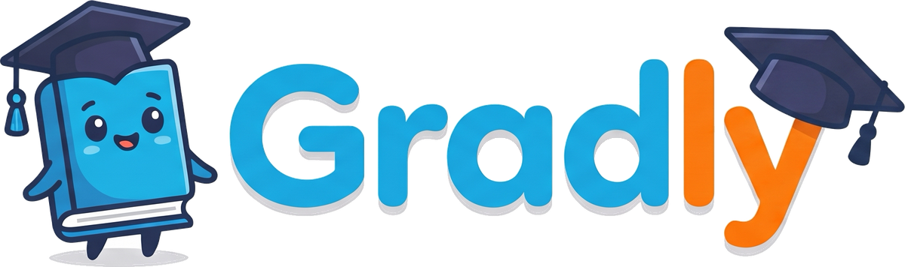
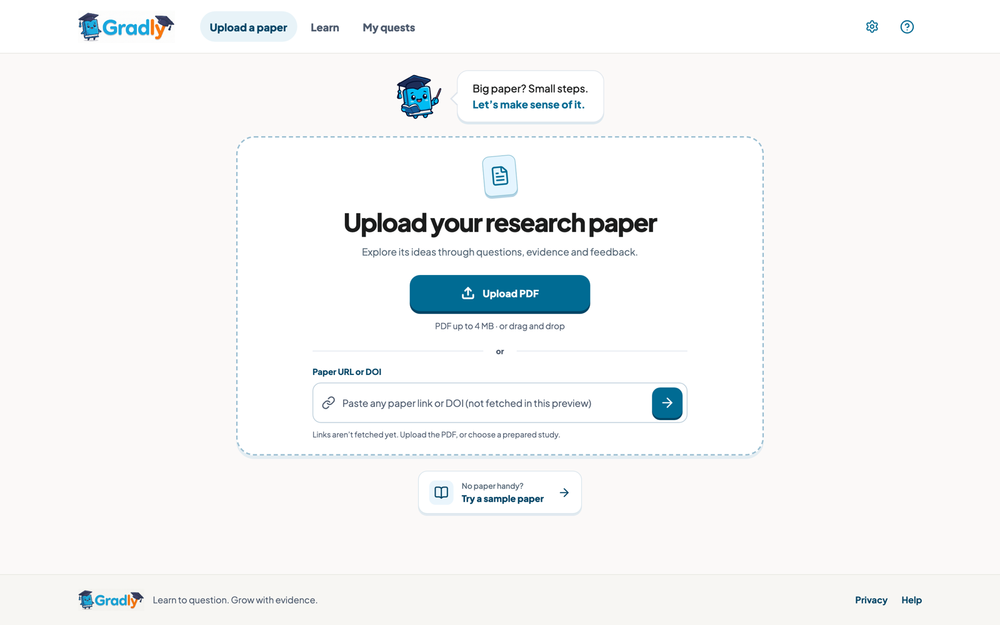
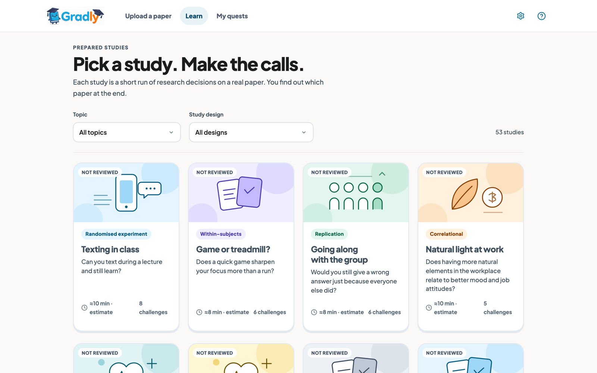
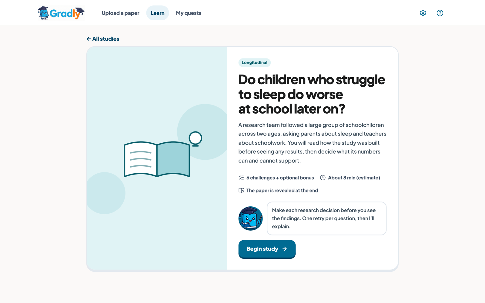
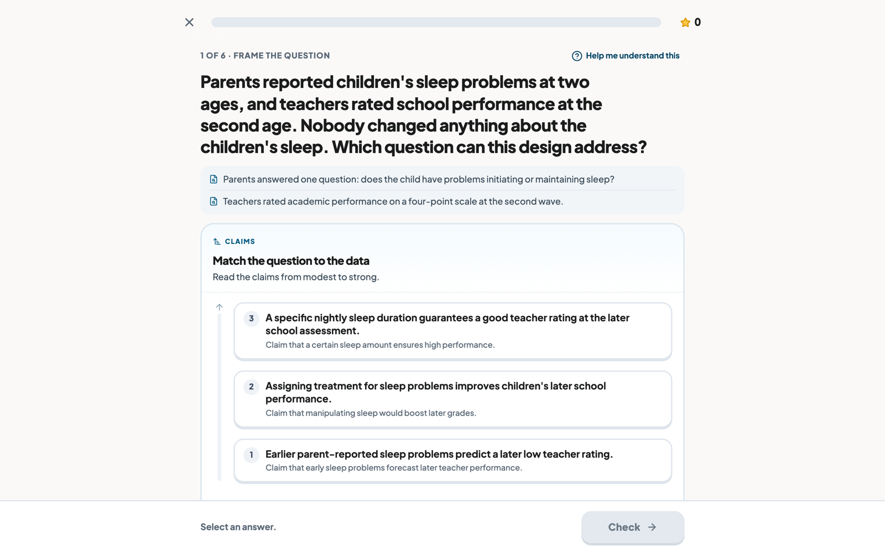
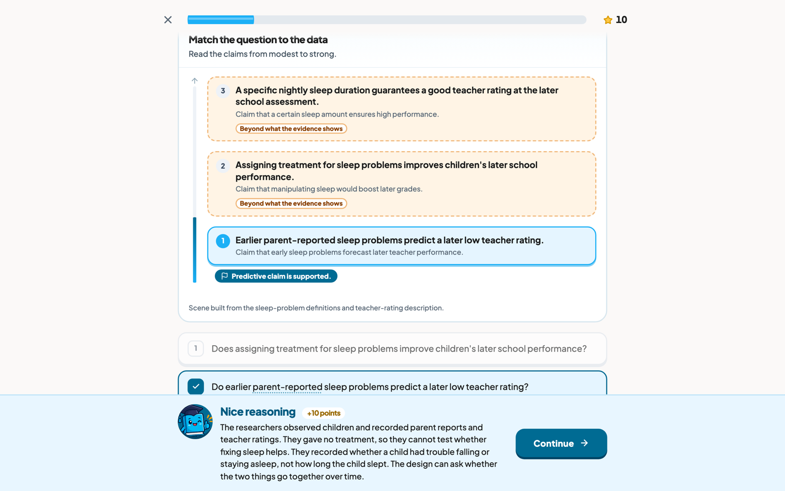
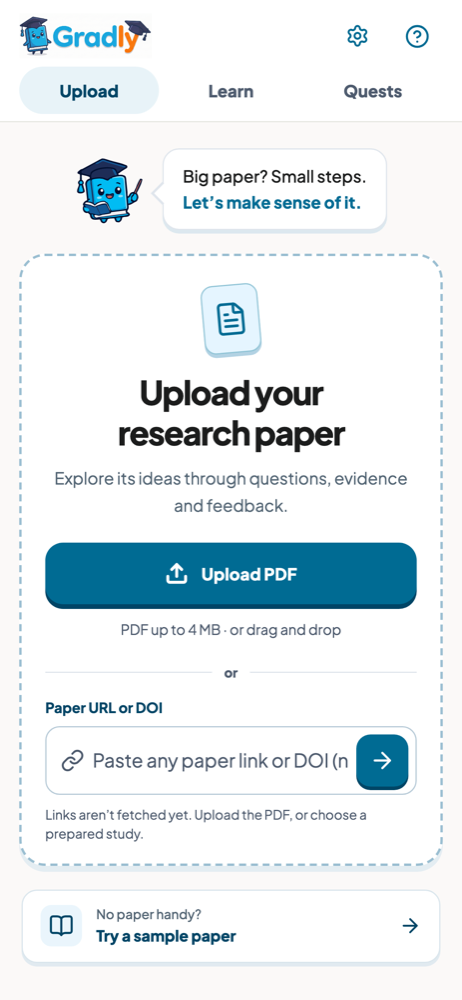
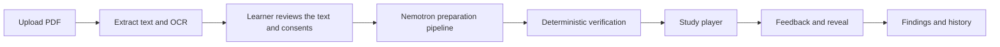

<p align="center">
  
</p>

<p align="center">
  <strong>Learn to question. Grow with evidence.</strong><br>
  Gradly turns a research paper into a short run of research decisions, checked against the paper's own words.
</p>

<p align="center">
  <a href="https://gradly-ai.vercel.app"><strong>Try the live app</strong></a>
  ·
  <a href="https://www.youtube.com/watch?v=_Z3_OLUyXOE"><strong>Watch the demo</strong></a>
  ·
  <a href="#how-it-works">How it works</a>
  ·
  <a href="#built-with-nebius-and-nvidia">Nebius and NVIDIA</a>
  ·
  <a href="#run-it-locally">Run it locally</a>
</p>

<p align="center">
  
  
  
  
</p>

<p align="center">
  
</p>

## Demo video

<p align="center">
  <a href="https://www.youtube.com/watch?v=_Z3_OLUyXOE">
    
  </a>
  <br>
  <sub><a href="https://www.youtube.com/watch?v=_Z3_OLUyXOE">Watch the 2-minute demo on YouTube</a>: uploading a real paper, the Nemotron-prepared quest, and the paper reveal.</sub>
</p>

## The problem

Students are told to "read the literature," but a research paper is a dense wall of methods, numbers and hedged claims. Summaries skip the part that matters: deciding what a study can and cannot show. Most students never practise that judgment until a professor marks it wrong.

Gradly makes that judgment the activity. Instead of summarising a paper, it asks you to make the calls the researchers made. Which question can this design answer? Does this result support a causal claim? What would change your mind? You commit to an answer, see the evidence, and get feedback before the paper's findings are revealed.

**Who it is for:** undergraduates and early graduate students in research-methods, psychology, education and health courses, and anyone who wants to read studies more critically.

## Meet the guide

<table>
  <tr>
    <td align="center" width="25%"><br><sub>Explains each step</sub></td>
    <td align="center" width="25%"><br><sub>Asks you to commit first</sub></td>
    <td align="center" width="25%"><br><sub>Gives feedback on the call</sub></td>
    <td align="center" width="25%"><br><sub>Celebrates a finished study</sub></td>
  </tr>
</table>

Gradly's mascot is a book in a graduation cap. It reacts to each stage of a study: it frames the question, waits while you decide, then explains why a claim is or is not supported.

## Screenshots

<table>
  <tr>
    <td width="50%"><br><sub><strong>Learn.</strong> 53 prepared studies on real, openly available papers, filterable by topic and study design.</sub></td>
    <td width="50%"><br><sub><strong>Study briefing.</strong> A plain-language setup of the study. The paper's identity is revealed at the end.</sub></td>
  </tr>
  <tr>
    <td width="50%"><br><sub><strong>Make the call.</strong> Each challenge quotes the paper's own evidence and asks for a research decision.</sub></td>
    <td width="50%"><br><sub><strong>See why.</strong> Claims beyond the evidence are marked, and the guide explains the design's limit.</sub></td>
  </tr>
</table>

<p align="center">
  <br>
  <sub>Every screen is built for phone, tablet and desktop widths.</sub>
</p>

## Features

- **Upload any research PDF.** Gradly validates the file, extracts each page, runs bounded English OCR on scanned pages, and shows the extracted text beside the original so you can check it before anything is sent to a model.
- **Paper-grounded challenges.** Nemotron drafts 3 to 8 challenges per paper. Every challenge cites exact excerpts from the paper, and the server rejects any lesson whose quotes do not match the extracted text word for word.
- **Decide before you see the results.** Findings, statistics and the paper's identity stay hidden on the server until the learning engine allows them. You reason about the design first, then check your call.
- **Interactive scenes.** Thirteen scene types, including claim ladders, sorting, timelines, comparisons and design matrices, turn a multiple-choice question into something you inspect and manipulate.
- **Explanation feedback.** Write why you chose an answer. Nemotron reviews your reasoning against only the evidence you have already seen and asks one targeted follow-up question. Replies that cite other evidence or name the paper are rejected, and feedback never changes your score.
- **Terms explained in context.** Tap a highlighted term such as "parent-reported" or "confound" for a definition written for this study, without giving away the answer.
- **One retry, then an explanation.** A wrong answer gets a hint and a second attempt. After that, the guide explains the reasoning.
- **Prepared-study library.** 53 ready-made studies on openly licensed or free-to-read papers, so anyone can try Gradly without uploading a file.
- **Practice points and saved progress.** Each solved challenge earns 10 points, once. Progress is saved to a private guest profile, and **My quests** lets you resume or delete any paper.
- **Accessible and calm.** Full keyboard support, automated accessibility checks, and a reduced-motion setting that turns animation off.

## How it works



1. **Add a paper.** Upload a PDF (up to 4 MB). The server checks its contents, extracts up to 80 pages and OCRs up to six low-text pages. The original PDF bytes are never stored.
2. **Review and consent.** You inspect the extracted text page by page. Nothing goes to an AI model until you confirm.
3. **Preparation.** The server runs seven sequential stages, each a separate role prompt to Nemotron on Nebius. The browser shows each stage's real saved status.
4. **Play.** The browser receives one challenge at a time, with no answer keys. Answers are scored on the server.
5. **Reveal and review.** After you commit, Gradly reveals the evidence, the findings and finally the paper itself.

### The preparation pipeline

| Stage | Role | What it does |
| --- | --- | --- |
| 0 | Evidence Analyst | Pulls exact excerpts for the question, design, findings and limits, and lists what the paper does not report |
| 1 | Lesson Architect | Drafts 3 to 8 challenges that cite those excerpts, with a hint and explanation for each |
| 2 | Scene Designer | Drafts one interactive scene per challenge from its prompt and evidence, never its answer key, then runs a leak check |
| 3 | Terms Guide | Writes study-specific definitions for unfamiliar terms and drops any that leak an answer |
| 4 | Methods Reviewer | Reviews the lesson for methodological errors and overreach |
| 5 | Learning Coach | Reviews clarity and teaching quality |
| 6 | Verification | Code, not a model. Checks every quote, page and reference, and blocks play if anything fails |

Document text is treated as untrusted data. Prompts forbid following instructions embedded in the paper, the pipeline has no tools or URL fetching, and model output renders as escaped text.

## Built with Nebius and NVIDIA

| | |
| --- | --- |
| **Inference** | [Nebius Token Factory](https://tokenfactory.nebius.com), OpenAI-compatible endpoint `https://api.tokenfactory.us-central1.nebius.com/v1` |
| **Model** | `nvidia/nemotron-3-super-120b-a12b` (NVIDIA Nemotron 3 Super) for every pipeline stage and for explanation feedback |
| **Structured output** | Each stage sends a JSON Schema. Replies are parsed again with Zod, and the model ID and finish reason are checked |
| **Guardrails** | One retry on timeouts and selected transient errors, per-guest and shared request budgets, and explicit "unavailable" states. A provider failure never silently becomes sample content |

### Why Nemotron 3 Super

We did not pick the model by name. We ran a [240-run evaluation](docs/research/NEMOTRON_EVALUATION.md) of four Nemotron models on Nebius, with thinking on and off, across two papers in five variants (short excerpt, full paper, results removed, OCR scan, and prompt injection). The full run cost **$4.35**.

- **Super was the only model whose outputs always parsed** and never hit the token limit. It quoted the paper exactly most often and invented no numbers with thinking on.
- **Ultra passed the evidence gate in 0 of 60 runs** and cost about five times as much, so we moved off it.
- **No model followed the injected instruction** in any of the 48 injection runs.
- **Exact quoting falls with length.** Super quoted exactly 91% of the time on two-page excerpts (up to about 15,000 characters) and 35% on full papers. That result is why every quote is verified in code before a learner sees it.

### Where Token Factory accelerated our workflow

- **Model choice in an afternoon.** One API key exposed all four Nemotron 3 models (Ultra, Super, Nano and Lightning), so we compared them on our real pipeline in 240 runs for $4.35 instead of deploying and hosting each one.
- **No infrastructure to run.** We used no GPU instances. Our Vercel-hosted server calls Token Factory's OpenAI-compatible endpoint, and Nebius handles serving and scaling.
- **Small integration.** The OpenAI-compatible API needed only a thin adapter (`apps/api/src/research/provider.ts`), and JSON Schema output plugged straight into our Zod validation.
- **Cheap to iterate.** Per-token pricing kept development and every learner upload at a few cents, so we could rerun the full seven-stage pipeline freely while improving prompts and checks.

**Nebius services used:** Nebius Token Factory (serverless inference of NVIDIA Nemotron 3 Super). No other Nebius services were used. **NVIDIA open models used:** Nemotron 3 Super in production; Nemotron 3 Ultra, Nano and Lightning in the evaluation only.

### Feedback on Nebius Token Factory and Nemotron

- **What worked.** The OpenAI-compatible API meant a small adapter. JSON Schema output and published per-token prices made a large, cheap model comparison practical. Nemotron 3 Super was consistent enough to run a seven-stage pipeline on every upload.
- **What needs work.** Nebius rejected the JSON Schema `propertyNames` keyword (HTTP 400 on Ultra, 500 on Super) before generation. We now strip it from requests and keep it in local validation. Models also tended to answer a schema's `https://` URL pattern with the bare string `"https://"`.
- **Would we use it again?** Yes. The main lesson was to verify citations in code rather than trust any model to quote long documents exactly.

## Hackathon

Built for the **[Nebius Global AI Hackathon](https://nebiusglobalaihackathon.devpost.com/)** with NVIDIA.

- **Built during the submission period.** The first commit is dated October 14, 2026.
- **Demo video:** [watch on YouTube](https://www.youtube.com/watch?v=_Z3_OLUyXOE). A 2-minute walkthrough recorded from the live app, built with [Remotion](https://www.remotion.dev) in [`apps/video`](apps/video/README.md).
- **Team:** [@Zeraphim](https://github.com/Zeraphim), [@marcxxv](https://github.com/marcxxv), [@jananonuevo](https://github.com/jananonuevo), [@mcjakey1](https://github.com/mcjakey1)

## Run it locally

Requires **Node.js 22** (22.18 or newer) and npm.

### Preview without an AI key

```sh
npm ci
npm run dev:preview
```

Open **http://127.0.0.1:5173**. This starts the web app and the local API with SQLite and disables all external AI calls. Real PDF extraction still runs. The prepared-study library works fully, and uploads can continue into a clearly labeled sample lesson.

### Live mode with Nemotron

```sh
cp .env.example .env
```

Set these values in `.env`, then run `npm run dev`:

```dotenv
NEBIUS_API_KEY=your_server_only_key
PREVIEW_MODE=false
DEMO_MODE=false
```

The key stays on the server and is never sent to the browser. To override the model, set `NEBIUS_PIPELINE_MODEL` or `NEBIUS_FEEDBACK_MODEL`. The full variable list is in [RESEARCH_INTEGRATION.md](docs/RESEARCH_INTEGRATION.md#vercel-configuration).

### Checks and production build

```sh
npm run check      # type checks, unit and research tests, production build
npm run test:e2e   # Playwright browser tests
npm run build
npm start          # serves the built app and API at http://127.0.0.1:3001
```

[TESTING.md](docs/TESTING.md) lists every suite and the opt-in live checks, which make billed model calls.

<details>
<summary><strong>Deploy to Vercel</strong></summary>

The repository root deploys with the static and Node builders in `vercel.json`. `npm run build:vercel` builds the interface into a generated `public/` directory, and `server.ts` exports the Express app as the function. The function allows 240 seconds for OCR and pipeline stages.

Hosted research features need `RESEARCH_ENABLED=true`, a remote libSQL `DATABASE_URL` and `DATABASE_AUTH_TOKEN`, a `SESSION_SECRET`, a `CRON_SECRET` for retention cleanup, and `NEBIUS_API_KEY` with `PREVIEW_MODE=false`. Sample mode is refused on Vercel and in production.

```sh
npx vercel link --yes --project nebius-hackathon-submission --scope <your-workspace>
npx vercel deploy --prod
```

See [RESEARCH_INTEGRATION.md](docs/RESEARCH_INTEGRATION.md) for the setup sequence and the [delivery skill](.agents/skills/vercel-delivery/SKILL.md) for release checks.

</details>

## Architecture

```text
apps/web               React and Vite learner interface, scenes, motion and styles
apps/api               Express server: PDF extraction, OCR, Nemotron pipeline, storage
packages/contracts     Shared request, response, lesson and scene types
packages/lesson-state  Attempts, reveal timing, progression and unique rewards
scripts                Dev orchestration, model evaluation and study generation
tests                  Unit, research and Playwright browser tests
```

TypeScript throughout, with npm workspaces. SQLite locally, remote libSQL when hosted. Guests are identified by signed HttpOnly cookies, not accounts.

More detail: [Architecture](docs/ARCHITECTURE.md) · [Design](docs/DESIGN.md) · [Requirements](docs/REQUIREMENTS.md) · [Learning design](docs/RESEARCH_LEARNING_DESIGN.md) · [Scene authoring](docs/SCENE_AUTHORING.md) · [Documentation index](docs/CONTEXT.md)

## Limits and data

- **Points measure participation, not mastery.** Gradly has not been tested in a learner study. Automated tests show the software works, not that students learn more.
- **Prepared studies are marked "Not reviewed"** until a subject expert checks them.
- **Verification catches bad quotes, not every bad inference.** Code checks quotes, pages and references. Reviewer stages check meaning, and a model can still misread a supported excerpt.
- **OCR is English only** and limited to six scanned pages per paper. Compare transcriptions with the original.
- **Paper links are not fetched yet.** Upload the PDF instead.
- **Data retention.** Extracted text and progress expire after 30 days. Original PDFs are never stored. You can delete any paper and its sessions from My quests.

## Contributing

Shared agent and contributor rules live in [AGENTS.md](AGENTS.md), project skills in `.agents/skills/`, and the documentation index in [docs/CONTEXT.md](docs/CONTEXT.md). See [docs/README.md](docs/README.md) for documentation provenance and context checks.

## License

Application code is released under the [MIT License](LICENSE). Fonts, packages and the referenced papers keep their own licenses. See [docs/research/papers/README.md](docs/research/papers/README.md) for each stored paper's source and license.
